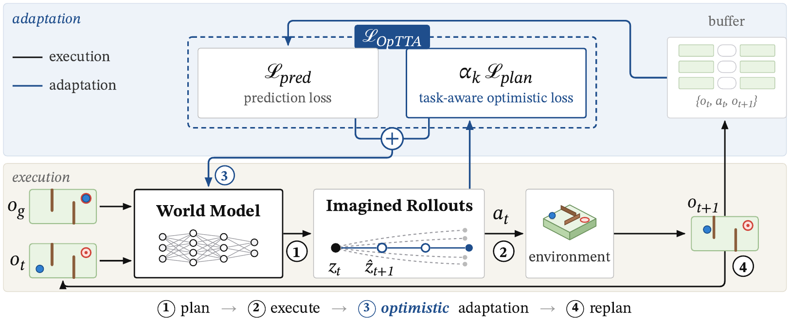
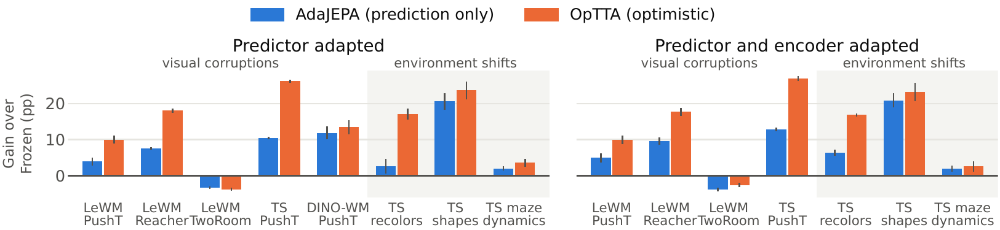

# OpTTA: Optimistic Test-Time World Model Adaptation

[Paper](https://arxiv.org/abs/2610.35636) | [Webpage](https://akshaymete.com/projects/optta)

OpTTA is a test-time adaptation method for latent world models used in planning.



Latent world models are usually frozen at test time, so planning with them degrades under distribution shift.
Prediction-only test-time adaptation (AdaJEPA) fits the model to the outcomes of its own actions. OpTTA adds the
planner's goal-reaching cost on its candidate rollouts to the adaptation objective, which biases adaptation toward
models that are optimistic about reaching the goal, with no extra environment interaction.



*Gain in final planning success over the frozen model, averaged over the visual corruptions or environment shifts of
each setting. Error bars show ±1 s.e. over seeds.*

## Implementations

| Folder | World model | Tasks |
|---|---|---|
| [`lewm/`](lewm/) | LeWM | PushT, Reacher, TwoRoom |
| [`temporal_straightening/`](temporal_straightening/) | Temporal straightening | PushT, PushObj, PointMaze-medium; CEM and gradient planner |
| [`dino_wm/`](dino_wm/) | DINO-WM | PushT |

Each folder's README covers setup, data and how to run Frozen, AdaJEPA and OpTTA.

## Using OpTTA

OpTTA adds the planner's cost on its last candidates to the prediction loss of each test-time update, with a weight
set by ρ (ρ = 0 is AdaJEPA; the paper uses ρ = 1 throughout). To use it with another world model or planner, start
from `OpTTAAdapter.optimism_gradient` in [`lewm/code/lewm_optta/adapter.py`](lewm/code/lewm_optta/adapter.py) or
`OpTTATrainer` in [`temporal_straightening/code/planning/optta.py`](temporal_straightening/code/planning/optta.py).

## Citation

```bibtex
@misc{mete2026adapt,
      title={Adapt for Planning, Not Just Prediction: Optimistic Test-Time World Model Adaptation},
      author={Akshay Mete and Dileep Kalathil and P. R. Kumar},
      year={2026},
      eprint={2610.35636},
      archivePrefix={arXiv},
      primaryClass={cs.LG},
      url={https://arxiv.org/abs/2610.35636},
}
```

## Acknowledgement

`temporal_straightening/` and `dino_wm/` build on [AdaJEPA](https://github.com/agentic-learning-ai-lab/adajepa),
[temporal straightening](https://github.com/agentic-learning-ai-lab/temporal-straightening) and
[DINO-WM](https://github.com/gaoyuezhou/dino_wm) (MIT, `code/LICENSE`), and include
[DINOv2](https://github.com/facebookresearch/dinov2) at commit `b48308a` (Apache-2.0, `third_party/dinov2/LICENSE`).
`lewm/` uses [stable-worldmodel](https://github.com/galilai-group/stable-worldmodel) and the
[LeWM](https://github.com/lucas-maes/le-wm) release checkpoints. We thank the authors for sharing their code.

## License

MIT ([`LICENSE`](LICENSE)). Third-party code keeps its own license, as listed above.
